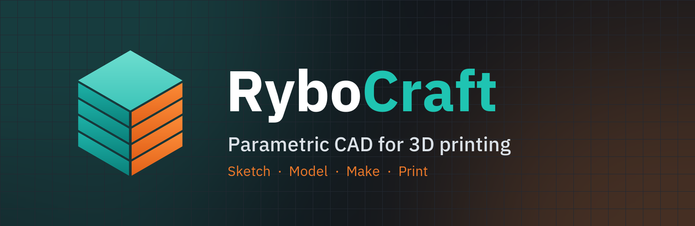
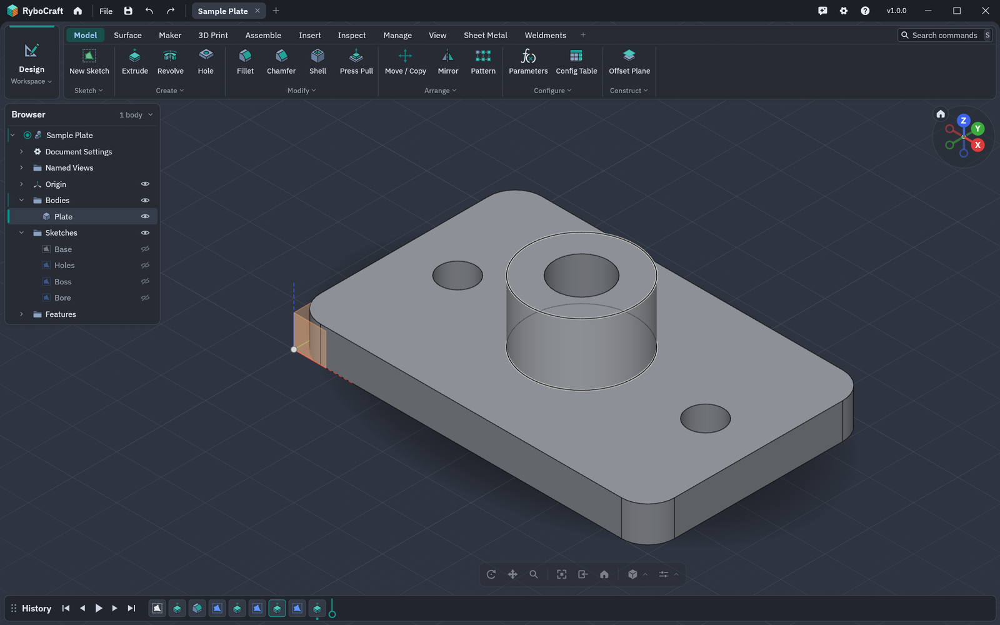
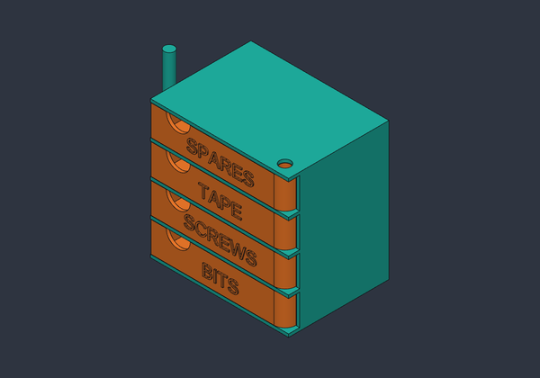
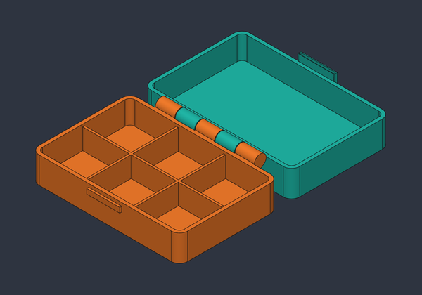
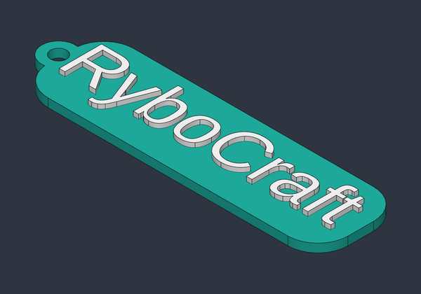
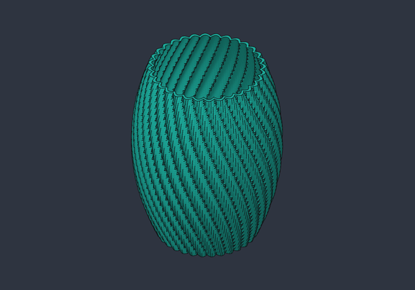
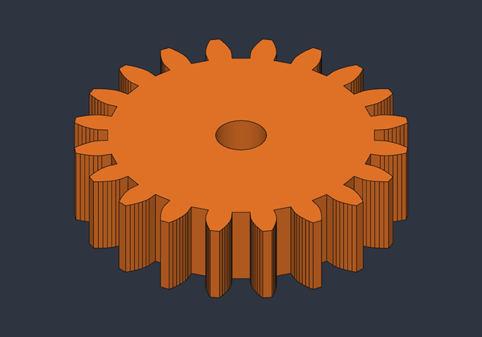
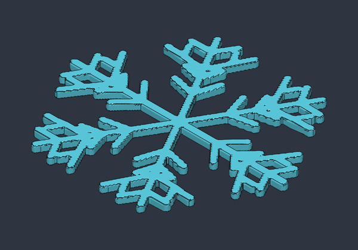
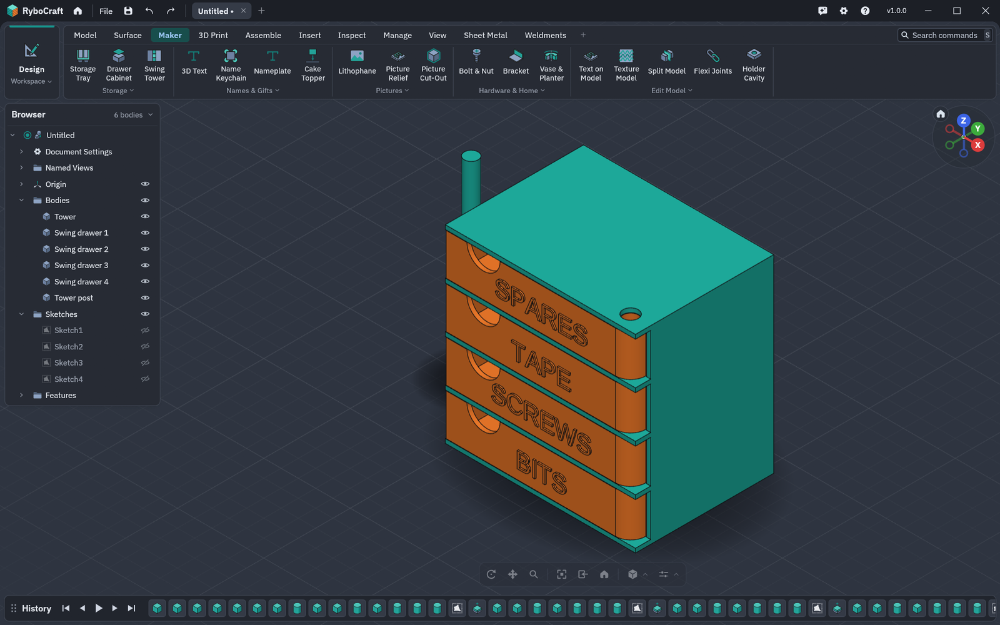
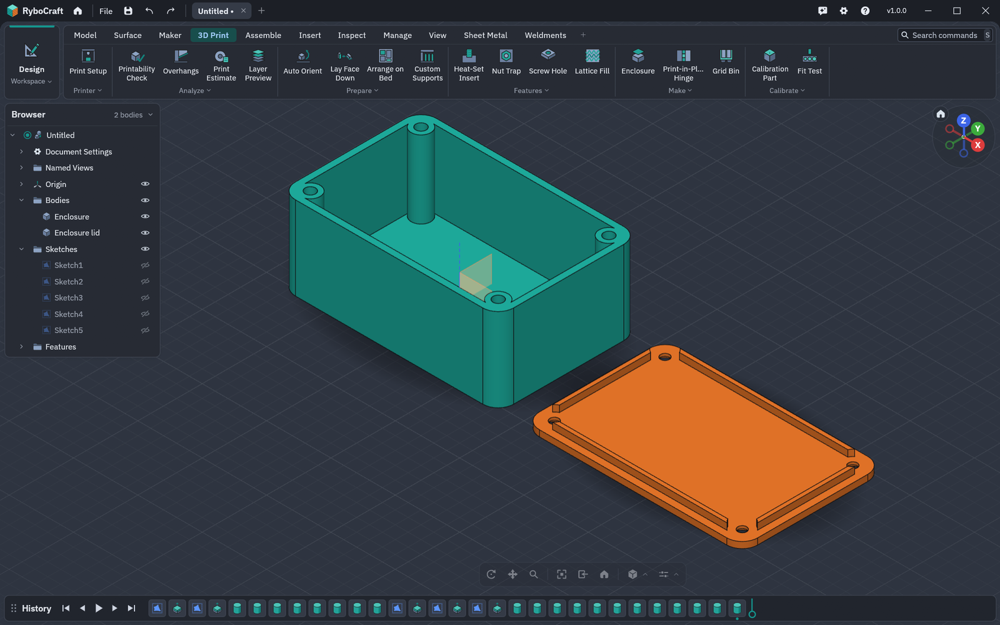

<p align="center">
  
</p>

<p align="center">
  <a href="#licence"></a>
  
  
  <a href="#-use-it-from-an-ai-agent"></a>
</p>

<p align="center">
  <b>Sketch it, constrain it, extrude it, then change one number and watch the whole part rebuild.</b><br>
  RyboCraft is a parametric CAD app made for people who print what they design,<br>
  by <b>R.G. Studios</b> (Ryan B. Gyles).
</p>

<p align="center">
  
</p>

---

## ✨ Why RyboCraft

<table>
  <tr>
    <td width="33%" valign="top">
      <h3>📐 Real parametric CAD</h3>
      Sketches with constraints, a feature timeline and an exact B-rep kernel: extrude, revolve,
      fillet, chamfer, shell, holes, patterns, sheet metal and assemblies. Change a parameter and
      every feature after it updates.
    </td>
    <td width="33%" valign="top">
      <h3>🧩 One-click Maker</h3>
      Trays, drawer towers, hinged boxes, vases, gears, keychains, lithophanes, cookie cutters and
      more, each made by one command with settings you can change afterwards.
    </td>
    <td width="33%" valign="top">
      <h3>🖨️ Ready for the printer</h3>
      Check overhangs, wall thickness and islands, preview layers, estimate filament and time,
      orient and arrange on the bed, then send it to your slicer.
    </td>
  </tr>
</table>

## 🧰 Made with one command

Every part below came out of a single Maker or 3D Print command with its default settings,
then got a colour.

<table>
  <tr>
    <td align="center"><br><sub><b>Swing Tower</b> · <code>make.swing_tower</code></sub></td>
    <td align="center"><br><sub><b>Hinged Box</b> · <code>make.hinged_box</code></sub></td>
    <td align="center"><br><sub><b>Name Keychain</b> · <code>make.keychain</code></sub></td>
  </tr>
  <tr>
    <td align="center"><br><sub><b>Vase &amp; Planter</b> · <code>make.vase</code></sub></td>
    <td align="center"><br><sub><b>Printable Gear</b> · <code>print.gear</code></sub></td>
    <td align="center"><br><sub><b>Snowflake</b> · <code>make.snowflake</code></sub></td>
  </tr>
</table>

## 🏗️ Maker



<details>
<summary><b>Everything in the Maker tab</b></summary>
<br>

- **Storage:** storage trays, drawer cabinets, swing towers, hinged boxes, pegboard holders, desk cups.
- **Names and gifts:** 3D text, name keychains, nameplates, cake toppers, balloon letters, ornaments, snowflakes, coasters, QR codes.
- **Pictures:** lithophanes, picture reliefs, cut-outs, cookie cutters, SVG to solid.
- **Hardware and home:** bolts and nuts, brackets, vases and planters, dice, marble track, device stands.
- **Edit any model, STL or solid:** text on a model, texture, split, flexi joints, holder cavities, moulds, hollow, puzzle pieces, flat base, resize, hanging loop, fuse and cut.

</details>

## 🖨️ 3D Print



| | |
|---|---|
| **Printer** | printers, filaments, slicing defaults, send to slicer |
| **Analyze** | printability score, overhangs, wall thickness, islands, layer preview, print estimate, filament comparison |
| **Prepare** | auto orient, lay face down, drop to bed, arrange, scale to bed, shrinkage, supports, brim ears, split to fit with pins |
| **Features** | heat-set inserts, nut traps, screw holes, magnet pockets, teardrop holes, lattices, hollow and drain, vents, keyholes |
| **Make** | enclosure, print-in-place hinge, grid bins and base plates, gear, knob, hook, spacer |
| **Calibrate** | cube, tolerance, overhang, bridging, temperature, retraction, first layer, thin wall, hole and fit tests |

## 🤖 Use it from an AI agent

Everything in RyboCraft is a command (`make.*`, `print.*`, `solid.*`, `sketch.*` …), so the
command-line tool and its built-in MCP server can do everything the app can. To connect Claude Code:

```sh
claude mcp add rybocraft -- rybocraft-cli mcp
```

Then ask for a part in plain words: *"make me a 4-drawer swing tower labelled SCREWS, BITS, TAPE, SPARES"*.

## 🛠️ Build it

You need [Rust](https://rustup.rs). Then, from this folder:

```powershell
cargo run --profile profiling -p rybocraft
```

To build the Windows installer:

```powershell
powershell -ExecutionPolicy Bypass -File packaging/windows/build-installer.ps1
```

The installer, `dist/RyboCraft-Setup-<version>.exe`, installs to
`C:\Program Files\RG Studios\RyboCraft`; `/S` installs silently.

## Licence

MIT OR Apache-2.0, at your option ([LICENSE-MIT](LICENSE-MIT), [LICENSE-APACHE](LICENSE-APACHE)).
The required notices for the open-source code and assets RyboCraft includes are in
[NOTICE](NOTICE), [ATTRIBUTION.md](ATTRIBUTION.md) and
[THIRD-PARTY-LICENSES.txt](THIRD-PARTY-LICENSES.txt). See also [DISCLAIMER.md](DISCLAIMER.md).

<p align="center"><sub>Made by <b>R.G. Studios</b> · Ryan B. Gyles</sub></p>
